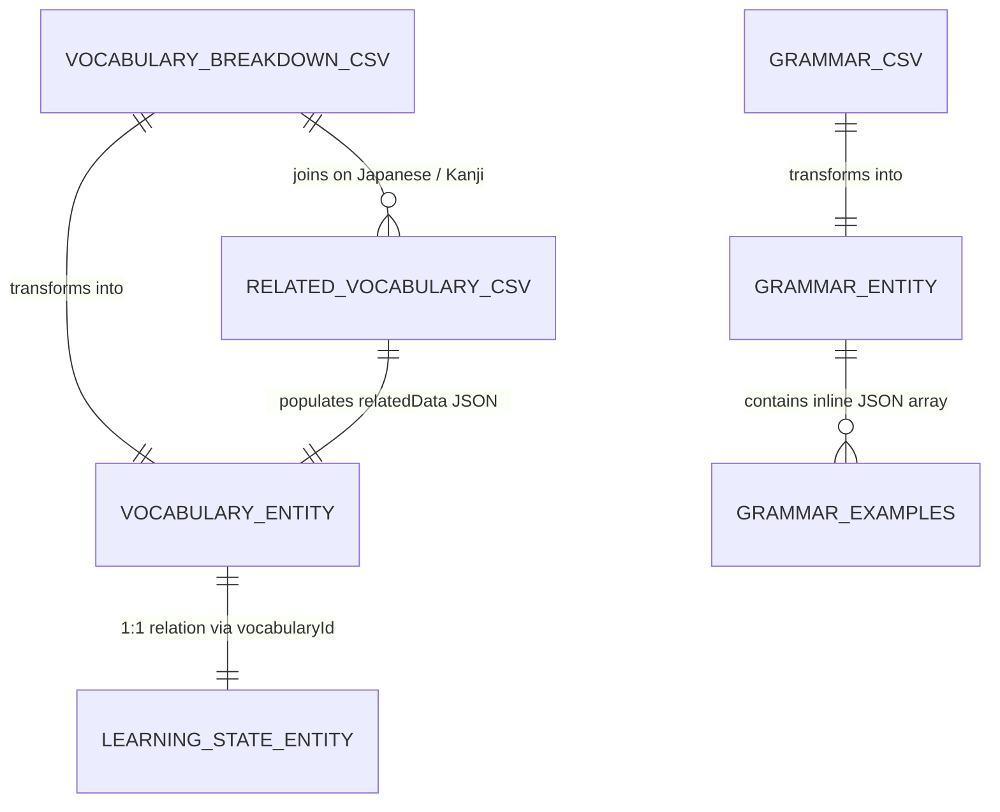

# Data Co-Relation & Architecture Guide

This document details how the CSV data files in the **JLPT Learning App** are interconnected, how datasets map to one another, and how they are ingested into the app's SQLite database via Room.

---

## 🏗 High-Level Data Architecture

The app uses two main learning tracks: **Vocabulary** (N5–N3) and **Grammar** (N5–N3). CSV datasets provide static seed data that gets merged and ingested at runtime.



---

## 🔗 Core File Interrelationships

### 1. Primary Entry ↔ Related Vocabulary (Vocabulary Track)

For each JLPT level (N5, N4, N3), two distinct CSV datasets are combined:

* **Breakdown CSV** (`jlpt_n{level}_breakdown.csv`) — Serves as the **primary key source**.
* **Related Vocab CSV** (`jlpt_n{level}_related_vocab.csv`) — Provides **supplementary compound words**.

#### Join Key Logic
- **Primary Link:** `kanji` column (Column Index 2)
- **Fallback Link:** `furigana/vocab` / reading (Column Index 3)

#### Data Merging Process in Code
1. `CsvImporter.importRelatedWordsMapFromStream()` parses `jlpt_n{level}_related_vocab.csv` into a memory `Map<String, String>` mapping `Japanese Key -> JSON Array String`.
2. `CsvImporter.importCsvFromStream()` parses `jlpt_n{level}_breakdown.csv` to construct base `VocabularyEntity` instances with radical breakdown JSON (`breakdownData`).
3. `VocabularyViewModel.loadMasterCsvData()` looks up each vocabulary word in the related map and attaches the JSON payload as `relatedData`.

```
[ jlpt_n5_breakdown.csv ]           [ jlpt_n5_related_vocab.csv ]
  kanji: "会う"                       kanji: "会う"
  meaning: "to meet"                 related: "会社 (company)", "会話 (conversation)"
           │                                   │
           └──────────────┬────────────────────┘
                          ▼
             [ VocabularyEntity (Room DB) ]
               japanese: "会う"
               breakdownData: '{"subKanjis":[{"kanji":"人","meaning":"person"}]}'
               relatedData: '[{"word":"会社","reading":"かいしゃ","meaning":"company"}]'
```

---

### 2. Source Files (`Data/`) ↔ Packaged Assets (`assets/`)

The repository maintains datasets in two directories:

| Source Dataset (`Data/`) | Packaged Asset (`app/src/main/assets/`) | Co-Relation / Description |
| :--- | :--- | :--- |
| `Data/jlpt_n3_breakdown_final.csv` | `assets/jlpt_n3_breakdown.csv` | Active production asset copied from source |
| `Data/jlpt_n4_breakdown_final.csv` | `assets/jlpt_n4_breakdown.csv` | Active production asset copied from source |
| `Data/jlpt_n5_breakdown_final.csv` | `assets/jlpt_n5_breakdown.csv` | Active production asset copied from source |
| `Data/dictionary/jlpt_n3_related_vocab.csv` | `assets/jlpt_n3_related_vocab.csv` | Active production dictionary asset |
| `Data/dictionary/jlpt_n4_related_vocab.csv` | `assets/jlpt_n4_related_vocab.csv` | Active production dictionary asset |
| `Data/dictionary/jlpt_n5_related_vocab.csv` | `assets/jlpt_n5_related_vocab.csv` | Active production dictionary asset |
| `Data/JLPT_Grammar_N5_N4_N3_natural_usage_examples.csv` | `assets/jlpt_grammar.csv` | Grammar master source dataset |

---

### 3. Current Assets ↔ Legacy Assets

Older app versions used simpler schemas before radical breakdowns and related words were added:

* **Legacy Files:** `N5Vocab.csv`, `N4Vocab.csv`, `N3Vocab.csv`, `jlpt_n4_breakdown_updated.csv`
* **Evolution:** 
  - Standard format (`Kanji, Kana, Romaji, Type, Meaning`) evolved into **Breakdown format** (`lvl, kanji, furigana, type, meaning, sub kanji 1..12, meaning 1..12, collective meaning`).
  - `CsvImporter` supports backward compatibility by auto-detecting column headers (checking for `"sub kanji"` or `"Kanji"`).

---

### 4. Grammar Track (`jlpt_grammar.csv`)

Grammar points are standalone entities that reference vocabulary words within their example sentences:

* **Columns:**
  - `Level` (N5, N4, N3)
  - `Grammar ID` (Unique identifier per pattern)
  - `Grammar` & `Reading`
  - `Meaning` & `Notes`
  - `Example 1..10 (Japanese & English Pairs)`
* **Database Representation:**
  - Standard fields map directly to `GrammarEntity` table columns.
  - Examples 1..10 are extracted dynamically into a structured JSON string (`examplesJson`) stored in SQLite.

---

## 📊 Database Schema Relationships

When CSVs are imported into the app's SQLite database ([`NihongoDatabase`](file:///C:/Users/dushy/StudioProjects/jlpt_learning_app/app/src/main/java/com/nihongo/app/data/database/NihongoDatabase.kt)), they form the following database entities:

### `vocabulary` Table (`VocabularyEntity`)
- `id` (Long, Auto-Generate Primary Key)
- `japanese` (String, e.g. "会う")
- `reading` (String, e.g. "あう")
- `romaji` (String)
- `type` (String, e.g. "V-godan")
- `meaning` (String)
- `jlptLevel` (String, "N5" | "N4" | "N3")
- `breakdownData` (JSON String of sub-kanji & radicals)
- `relatedData` (JSON String of related compound words)

### `learning_state` Table (`LearningStateEntity`)
- `id` (Long, Auto-Generate Primary Key)
- `vocabularyId` (Foreign Key -> `vocabulary.id`)
- `srsStage` (Int)
- `nextReviewTime` (Long)
- `correctCount` / `incorrectCount` (Int)

> [!NOTE]
> Inserting a new vocabulary item automatically initializes a corresponding `LearningStateEntity` row via `VocabularyViewModel`.

### `grammar` Table (`GrammarEntity`)
- `id` (Long, Auto-Generate Primary Key)
- `grammarId` (Int, from CSV ID column)
- `jlptLevel` (String)
- `grammar` (String)
- `reading` (String)
- `meaning` (String)
- `notes` (String)
- `source` (String)
- `examplesJson` (JSON String containing array of example objects)
- `isBookmarked` (Boolean)
